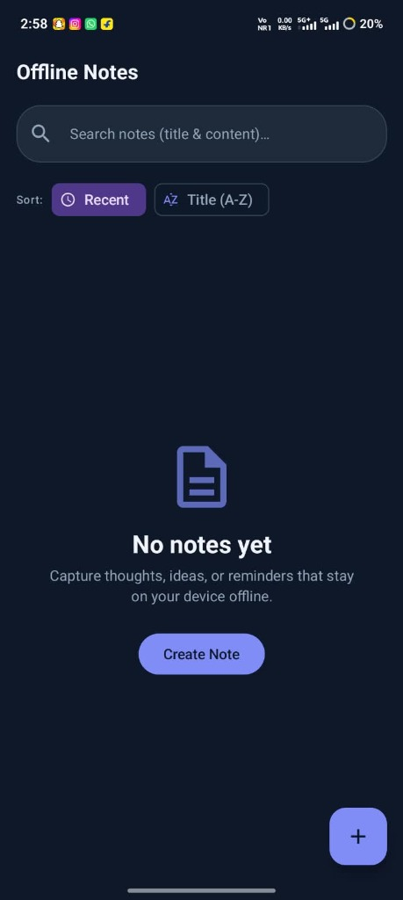
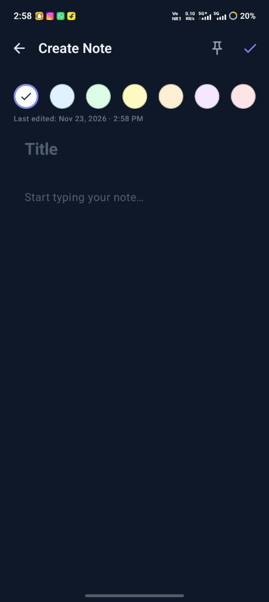
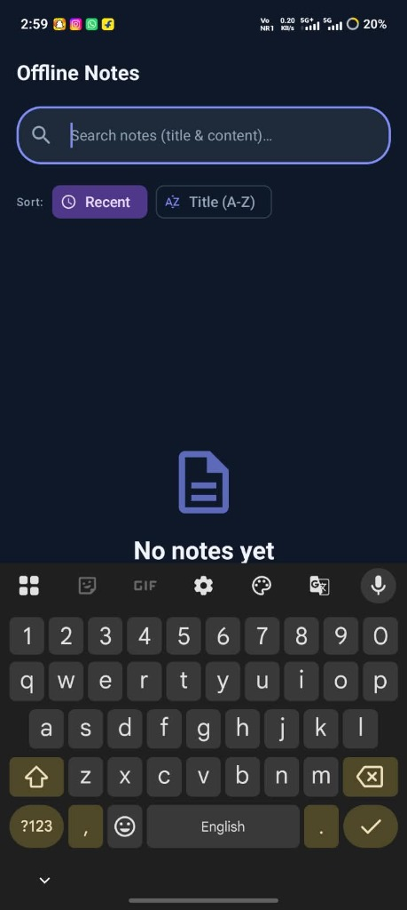

# Offline-First Notes App

A modern, polished, and maintainable Android Notes application built from scratch to be **100% offline-first**. 

Developed strictly in accordance with the Android Developer Hiring Assignment specifications using **Kotlin**, **Jetpack Compose (Material 3)**, **MVVM Architecture**, **Room Database**, and **Kotlin Coroutines / StateFlow**.

---

## 📸 Screenshots & UI Showcase

| 1. Home Screen (Empty State) | 2. Note Editor & Color Palette | 3. Real-Time Search & Keyboard |
| :---: | :---: | :---: |
|  |  |  |
| *Clean empty state, sort tabs (`Recent`, `Title A–Z`), and quick note creation CTA/FAB* | *Full editor with pin toggle, auto timestamp, and 7-color category palette* | *Instant, case-insensitive search across title & content with keyboard support* |

---

## 📱 Features

### Core Requirements
* **Offline-First Persistence**: Powered by Room Database SQLite. All notes, edits, and deletions persist across app restarts and process deaths. Requires zero network access or accounts.
* **Create & Edit Notes**: 
  * Rich fields for Title and Body Content.
  * Live character / timestamp tracking (`updatedAt` automatically updates upon saving).
  * **Blank Note Validation**: Completely empty notes (empty title and content) are blocked from saving with clear user feedback.
  * **Consistent Untitled Note Handling**: If a user leaves the title blank but enters content, the note is saved cleanly and consistently displays as `"Untitled note"` in the list preview.
* **Delete with Confirmation & Undo**:
  * Delete action available directly on note cards or in the editor.
  * Confirmation dialog to prevent accidental deletion.
  * Immediate **Undo action via Snackbar** restoring deleted notes to the database.
* **Search by Title & Content**:
  * Real-time search matching both note titles and body content.
  * **Case-insensitive** query matching (e.g., `android` matches `Android` or `ANDROID`).
  * Dedicated **No Results State** with a single-click "Clear Search" button.
* **Sorting**:
  * **Last Updated (Newest first)**: Default sorting based on the latest modification timestamp.
  * **Title (A–Z)**: Alphabetical sorting by note title.
* **UI State & Screen Preservation**:
  * Handles Loading, Empty ("No notes yet"), No Search Results, and Content states gracefully.
  * UI state is preserved across screen rotations and configuration changes using `ViewModel` and `StateFlow`.

### Bonus Features Implemented
* 📌 **Pin / Favorite Notes**: Pin vital notes to always remain at the top of the list regardless of the active sort order.
* 🎨 **Color Categories**: Curated pastel palette (Default, Sky, Mint, Lemon, Peach, Lavender, Rose) with visual indicators on cards and in the editor.
* 🌓 **Polished Dark & Light Theme**: Dynamic Material 3 theming with accessible contrast and custom typography.
* 🧪 **Comprehensive Test Coverage**: Unit tests and in-memory Room SQLite database tests for ViewModel, DAO, search, sorting, and edge cases.

---

## 🏗️ Architecture & Technical Stack

```
com.offlinefirst.notes
├── NotesApplication.kt           // Application class providing AppContainer DI
├── MainActivity.kt               // Single Activity entry point
├── data
│   ├── local
│   │   ├── dao
│   │   │   └── NoteDao.kt        // Room DAO with case-insensitive search & sorting
│   │   ├── database
│   │   │   └── NotesDatabase.kt  // RoomDatabase singleton
│   │   └── entity
│   │       └── NoteEntity.kt     // SQLite table entity
│   └── repository
│       ├── NoteRepository.kt     // Repository interface
│       └── NoteRepositoryImpl.kt // Concrete implementation wrapping Room DAO
├── model
│   ├── Note.kt                   // Domain model with display helpers
│   ├── NoteColor.kt              // Curated color palette
│   └── SortOrder.kt              // UPDATED_DESC, TITLE_ASC
├── ui
│   ├── navigation
│   │   ├── NavGraph.kt           // Jetpack Compose Navigation graph
│   │   └── Screen.kt             // Type-safe navigation routes
│   ├── notes
│   │   ├── NotesViewModel.kt     // MVVM ViewModel with StateFlow
│   │   ├── NotesViewModelFactory.kt
│   │   ├── NotesListUiState.kt   // Sealed/Data UI state for list screen
│   │   ├── NoteEditorUiState.kt  // UI state for note editor
│   │   ├── NotesListScreen.kt    // Compose Home & Search UI
│   │   ├── NoteEditorScreen.kt   // Compose Note Editor UI
│   │   └── components            // Reusable UI components (Cards, Dialogs, etc.)
│   └── theme                     // Material 3 typography, color schemes, themes
└── util
    └── DateFormatter.kt          // Relative & absolute date/time formatting
```

### Key Technologies:
* **Language**: Kotlin 2.0.21
* **UI Framework**: Jetpack Compose (BOM 2024.11.00) with Material 3
* **Local Persistence**: AndroidX Room 2.6.1 with KSP (`com.google.devtools.ksp:2.0.21-1.0.28`)
* **Asynchronous & Reactive**: Kotlin Coroutines 1.9.0, `Flow`, and `StateFlow`
* **Navigation**: Jetpack Navigation Compose 2.8.4
* **Testing**: JUnit 4, Kotlinx Coroutines Test, CashApp Turbine, Robolectric 4.14.1

---

## 🛠️ Setup & Build Instructions

### Prerequisites
* Android Studio Ladybug | Hedgehog or newer
* JDK 17 or JDK 21 (configured as Gradle JVM)
* Android SDK Platform 35 (`compileSdk = 35`, `minSdk = 24`)

### Build Commands
1. **Clone the repository**:
   ```bash
   git clone <repository-url>
   cd Offline-first-notes
   ```
2. **Compile the Debug APK**:
   ```bash
   ./gradlew assembleDebug
   ```
   *Generated APK Location*:
   `app/build/outputs/apk/debug/app-debug.apk`

3. **Execute All Unit & Acceptance Tests**:
   ```bash
   ./gradlew testDebugUnitTest
   ```

---

## 🧪 Acceptance Test Results

All 17 acceptance and unit tests executed and passed:

| Test Case | Scope | Status |
| :--- | :--- | :---: |
| `createNote_validTitleAndContent_savesSuccessfully` | Create note & verify list presence | ✅ PASSED |
| `blankInput_cannotBeSaved_validationErrorSet` | Blank note validation error | ✅ PASSED |
| `createNote_blankTitleWithContent_handledConsistently` | Blank title defaults to "Untitled note" | ✅ PASSED |
| `editNote_updatesContentAndModifiedTimestamp` | Edit text & verify `updatedAt` change | ✅ PASSED |
| `deleteNote_removesFromList_andUndoRestoresIt` | Delete note & restore via Undo | ✅ PASSED |
| `searchNotes_byTitle_isCaseInsensitive` | Title search with mixed case | ✅ PASSED |
| `searchNotes_byBodyContent_isCaseInsensitive` | Content search with mixed case | ✅ PASSED |
| `searchNotes_noMatches_setsNoResultsState` | Empty search state display | ✅ PASSED |
| `sortNotes_byUpdated_showsNewestFirst` | Sort order: Last updated | ✅ PASSED |
| `sortNotes_byTitle_ordersAlphabetically` | Sort order: Title A–Z | ✅ PASSED |
| `pinnedNotes_appearAtTopRegardlessOfSort` | Pinned priority in all sorts | ✅ PASSED |
| `insertAndGetNoteById` | Room SQLite persistence & retrieval | ✅ PASSED |
| `updateNote_modifiesDataAndTimestamp` | Room SQLite entity modification | ✅ PASSED |
| `deleteNote_removesFromDatabase` | Room SQLite entity deletion | ✅ PASSED |
| `searchNotes_isCaseInsensitive` | Room SQL query case-insensitivity | ✅ PASSED |
| `sortNotes_updatedDesc_ordersNewestFirst` | Room SQL query updated sorting | ✅ PASSED |
| `sortNotes_titleAsc_ordersAlphabetically` | Room SQL query title sorting | ✅ PASSED |

---

## 💡 Technical Discussion & Design Decisions

### 1. Why MVVM and how UI State flows from Room to Compose
* **Unidirectional Data Flow (UDF)**: Events travel up from Composables to `NotesViewModel` (e.g. `onSearchQueryChanged`), while UI State flows down from `Room` -> `Repository` -> `ViewModel` -> `Compose`.
* The ViewModel uses `combine` and `flatMapLatest` to merge user intent (search query + sort order) into a single reactive `Flow`. This is exposed to Compose as a lifecycle-aware `StateFlow<NotesListUiState>`.
* Compose observes this state via `collectAsStateWithLifecycle()` or `collectAsState()`, ensuring seamless recompositions without UI flicker or state loss across screen rotations.

### 2. How the Repository and DAO are separated and why
* `NoteDao` is strictly concerned with database tables and SQLite queries (`NoteEntity`).
* `NoteRepository` acts as the single source of truth for the domain layer, transforming low-level `NoteEntity` data models into clean domain models (`Note`).
* This enables unit testing the ViewModel with a fast, zero-dependency `FakeNoteRepository` without mocking Android/SQLite internals.

### 3. How duplicate or invalid saves are prevented
* Notes that have both an empty title and empty content are rejected at the ViewModel layer before hitting Room. An error message is exposed to the UI State to alert the user.
* Saving triggers a single coroutine launch with `OnConflictStrategy.REPLACE` on the DAO, preventing primary key collisions.

### 4. How search and sorting work, including edge cases
* In SQLite, ASCII `LIKE` is case-insensitive, but to ensure 100% reliability across all character sets, the DAO enforces `LOWER(title) LIKE '%' || LOWER(:query) || '%' OR LOWER(content) LIKE '%' || LOWER(:query) || '%'`.
* When sorting by Title (A–Z), notes with blank titles fallback to `"Untitled note"` in SQL (`CASE WHEN TRIM(title) = '' THEN 'Untitled note' ELSE TRIM(title) END`) so that untitled notes sort predictably alongside titled notes.

### 5. Trade-off & Resolution Encountered
* **Turbine Test Timing on StateFlow**: In Kotlin Coroutines, `stateIn(SharingStarted.WhileSubscribed)` waits for subscribers before activating upstream flows. In unit tests with `StandardTestDispatcher`, this can cause `awaitItem()` to receive the initial loading state before data emissions. 
* **Resolution**: Parameterized `NotesViewModel` with configurable `SharingStarted` (defaulting to `WhileSubscribed(5000)` in production and `Eagerly` in tests) and filtered out transient loading emissions in test assertions.

---

## 📦 Deliverable: APK Location

* **Debug APK Path**:
  `E:\Offline-first-notes\app\build\outputs\apk\debug\app-debug.apk`
* **File Size**: ~17.0 MB
* **Target Package**: `com.offlinefirst.notes`
